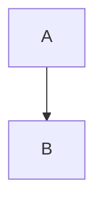

# Project [[Alpha]]

Intro paragraph with [[Some Note]] and an alias [[Other|friendly]] plus ![[embed.png]] inline.

> [!TIP]
> Callout body with **bold** and $$E=mc^2$$ inline.

:::toggle
Hidden content line.

- nested item
- another

:::

:::columns
:::column
left cell
:::

:::column
right cell
:::
:::

Meet on @2026-07-01 at noon.

<!-- an html comment the editor shows but never touches -->

<Steps>An unknown tag, held verbatim.</Steps>

Press <kbd>K</kbd> to open the palette, and <u>underline</u> stays a mark.

$$
\int_0^1 x^2 dx
$$

> [!NOTE]
> An alert body.

- [ ] a task with [[wiki]] and @2026-07-02
- [x] done task

| col | math  |
| --- | ----- |
| a   | $$x$$ |
